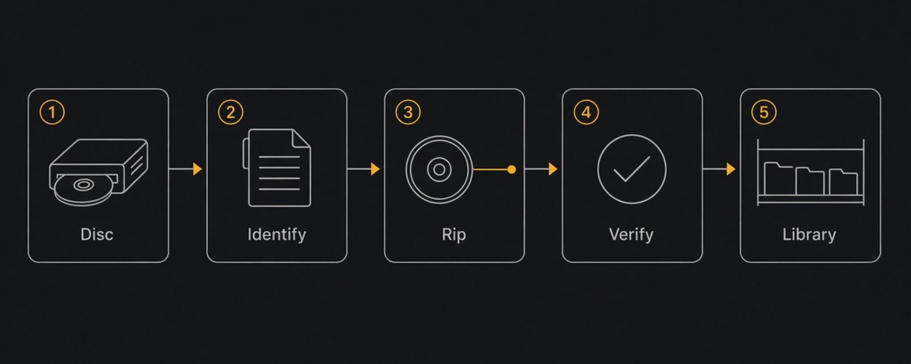

# Ripknife



AI-automated, config-driven disc rip.

Plug in the drive and put in the disc. Ripknife does the rest.

AI and scripts detect the disc, map it, write the config, rip it, and copy it to the library.

A disc of episodes becomes one file per episode. A movie that spans discs is joined into one file, and only that joined file is copied. Editions are named so the library can show them.

## Install

```bash
git clone https://github.com/DataKnifeAI/ripknife.git && cd ripknife && make install && cp -n .env.example .env
```

Put an OpenRouter key in `.env`. Point Ripknife at your library folders. That is the one-time setup.

## Developer

Run the watchers in this checkout, without installing a service:

```bash
make dev
```

Logs are in `logs/`. Stop with `make watch-stop`.

How the pipeline works, and how to change this repo, is in [docs/](docs/agent.md).
